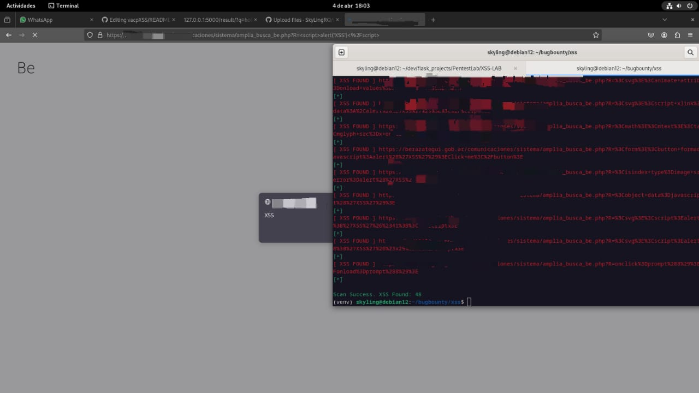

# 🛠️ vacpXSS

vacpXSS toma como entrada una lista de URLs (o endpoints) y las analiza inyectando múltiples payloads de XSS. Luego verifica si alguno de estos payloads se refleja directamente en la respuesta HTML sin ser filtrado o escapado, lo cual es un fuerte indicio de una vulnerabilidad XSS reflejada.
La herramienta puede ser utilizada tanto para entornos de testing como para escaneos rápidos sobre múltiples dominios objetivos.

---

# 📦 Instalación

```bash
go install github.com/SkyLingRQ/vacpXSS@latest
sudo mv go/bin /usr/bin
vacpXSS -h
```

---

# 🚀 Uso

```bash
Usage of ./vacpxss:
  -file string
    	Ruta del archivo con URLS. (default "urls.txt")
  -sem int
    	Implementar semaforo personalizado. (default 50)
```
## Linux Terminal
```bash
vacpXSS -file nombre_archivo.txt -sem Número de concurrencias simultáneas (slots de goroutines)
```
